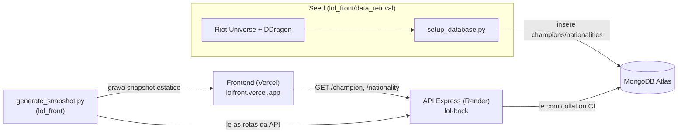

# LoL Back

API em Node.js/Express que serve dados de League of Legends (campeoes e faccoes/regioes) a partir de um MongoDB previamente populado pelo script [`data_retrival/setup_database.py`](https://github.com/IannCarvalho/lol_front/blob/main/data_retrival/setup_database.py) do [lol_front](https://github.com/IannCarvalho/lol_front).

**Live:** https://lol-back-6zld.onrender.com (Render, plano free) · health check em [`/status`](https://lol-back-6zld.onrender.com/status).

> ⚠️ No plano free do Render o servico "dorme" apos ~15 min sem trafego; a primeira requisicao depois disso leva ~30-50s (cold start).

## Stack

- Node.js 24 (LTS) — ESM nativo (`"type": "module"`), sem step de build. `engines` exige `>=20.19.0` (minimo do Mongoose 9).
- Express 5 (`^5.2.1`)
- Mongoose 9 (`^9.10.1`, MongoDB)
- Dev: Vitest 3 + Supertest (testes), ESLint 10 (lint)

## Arquitetura



- O **seed** (`setup_database.py`, no lol_front) busca os dados nas APIs publicas da Riot (Universe) e DDragon e grava nas colecoes `champions` e `nationalities`.
- A **API** (este repo) le o Mongo e serve as rotas de leitura, com cache HTTP e CORS.
- O **`generate_snapshot.py`** (lol_front) le as rotas desta API para gerar um snapshot estatico que o front usa como fallback.

## Estrutura

```
lol_back/
├── app.js              # entrypoint: env, abre o Mongo, createApp, listen, shutdown gracioso
├── index.js            # agrega os routers (/champion, /nationality)
├── lib/
│   ├── createApp.js    # fabrica do app Express (pura/testavel: CORS, JSON, /status, 404, erro)
│   └── database.js     # conexao com o MongoDB (dbName 'lol')
├── controllers/        # rotas HTTP (champion, nationality) — handlers async diretos
├── services/           # regras de negocio + queries (.lean(), collation CI)
├── models/             # schemas Mongoose (com indices nos campos de busca)
├── middleware.js       # cache HTTP (Cache-Control) e error handler central
├── util.js             # erros tipados (AppError/NotFound/BadRequest), mapMongooseError
├── eslint.config.js    # ESLint flat config
└── render.yaml         # Blueprint do Render (NODE_VERSION 24)
```

## Setup

```bash
npm install
cp .env_template .env   # e preencha os valores
```

Variaveis de ambiente (`.env`):

| Variavel           | Descricao                                                              |
|--------------------|------------------------------------------------------------------------|
| `PORT`             | Porta do servidor (default 5000 no app; o Render usa 10000 via env)    |
| `MONGO_URL`        | Connection string do MongoDB                                           |
| `ALLOWED_ORIGINS`  | Opcional: origens CORS separadas por virgula; sobrescreve o default    |

## Scripts

```bash
npm run dev        # desenvolvimento (hot reload via node --watch)
npm start          # producao (node app.js)
npm test           # roda a suite uma vez (Vitest)
npm run test:watch # testes em modo watch
npm run lint       # ESLint em todo o projeto
```

> O `dotenv` carrega o `.env` automaticamente. Health check: `GET /status` → `Status: Running`.

O entrypoint faz **desligamento gracioso** em `SIGTERM`/`SIGINT` (o Render manda `SIGTERM` em deploy/sleep): fecha o server e a conexao do Mongo antes de sair.

## Endpoints

| Metodo | Rota                                   | Descricao                          |
|--------|----------------------------------------|------------------------------------|
| GET    | `/status`                              | Health check (sem cache)           |
| GET    | `/nationality/`                        | Lista todas as regioes/faccoes     |
| GET    | `/nationality/:name`                   | Detalhe de uma regiao              |
| GET    | `/nationality/champions/:nationality`  | Campeoes de uma regiao             |
| GET    | `/champion/:slug`                      | Detalhe de um campeao              |

As rotas de dados respondem com `Cache-Control: public, max-age=600` (via o middleware `cacheControl`); o `/status` fica fora do cache para refletir o estado atual do servico.

### Exemplos

```bash
curl https://lol-back-6zld.onrender.com/nationality/Ionia
```

```json
{
  "_id": "66b0...",
  "slug": "ionia",
  "name": "Ionia",
  "image": "https://universe.leagueoflegends.com/images/ionia_emblem.png",
  "background": "https://cmsassets.rgpub.io/.../ionia.jpg",
  "overview": "Ionia e uma terra de magia natural..."
}
```

```bash
curl https://lol-back-6zld.onrender.com/champion/ahri
```

```json
{
  "_id": "66b0...",
  "slug": "ahri",
  "name": "Ahri",
  "title": "A Raposa de Nove Caudas",
  "lore": "...",
  "nationality": "Ionia",
  "image": "https://.../Ahri.png",
  "background": "https://.../Ahri_splash.jpg",
  "role": "Mago",
  "release-date": "2011-12-14",
  "url": "https://universe.leagueoflegends.com/pt_BR/champion/ahri/",
  "section-title": "..."
}
```

Os campos reais vem do seed: **nationality** traz `slug, name, image, background, overview`; **champion** traz `slug, name, title, lore, nationality, image, background` mais `_id` e os campos extras do seed (`role`, `release-date`, `url`, `section-title`).

## Contrato de erro

Toda resposta de erro e um JSON `{ "message": "..." }`. Status:

| Status | Quando                                                        | Corpo                                  |
|--------|---------------------------------------------------------------|----------------------------------------|
| 400    | Valor invalido para o campo (CastError/ValidationError)       | `{ "message": "Invalid value for field '<campo>'." }` |
| 403    | Origem nao permitida pelo CORS                                | `{ "message": "Origin not allowed by CORS." }` |
| 404    | Recurso nao encontrado OU rota inexistente                    | `{ "message": "<Recurso> not found." }` / `{ "message": "Route not found." }` |
| 500    | Erro interno (ex.: banco fora no cold start)                  | `{ "message": "Internal server error." }` (mensagem generica; o erro completo e logado no servidor) |

- **Lista vazia e `200 []`**, nao 404 — uma regiao sem campeoes cadastrados responde lista vazia, e o frontend conta com isso.
- Erros de infraestrutura (rede/timeout do Mongo) viram **5xx**, nunca 400: a mensagem interna nao vaza para o cliente.

## Busca por nome (collation)

As consultas por nome usam **igualdade com collation case-insensitive** (locale `en`, strength 2) — nao `$regex`. A troca (feita no PR #6) permite usar o indice do campo, que o `$regex /i` sem ancora nao aproveitava. Os indices em `models/*.js` declaram a mesma collation. Os campos indexados: `slug` e `nationality` em `champion`, e `name` em `nationality`.

## CORS

Sem `ALLOWED_ORIGINS`, o CORS libera o frontend em producao (`https://lolfront.vercel.app`) e o dev local (`http://localhost:5500`, `http://127.0.0.1:5500`). `ALLOWED_ORIGINS` (lista separada por virgula) sobrescreve esse default. Requisicoes **sem header Origin** (curl, health check) sao liberadas. A API e so leitura, entao anuncia apenas os metodos `GET` e `HEAD`.

## Deploy (Render)

O repositorio inclui um `render.yaml` (Blueprint): runtime Node, `NODE_VERSION=24`, plano free, health check em `/status`, `PORT=10000`. Ao criar um **Blueprint** apontando para este repo, o Render pede o valor de `MONGO_URL` (connection string do Atlas — nao vai versionada).

Pontos de atencao no MongoDB Atlas:
- **Network Access**: libere `0.0.0.0/0` (o Render free nao tem IP fixo), senao a conexao falha com erro de TLS/selecao de servidor.
- O nome do banco (`lol`) e forcado via `dbName` em `lib/database.js`, entao a `MONGO_URL` funciona com ou sem o `/lol` no path.

## Testes e lint

[Vitest](https://vitest.dev/) + [Supertest](https://github.com/ladjs/supertest). Os testes cobrem os helpers de `util.js`, as rotas de `champion`/`nationality` (services mockados, sem tocar o Mongo), os headers de cache e o app real montado via `createApp` (status, 404 JSON, CORS permitido/negado, 500 generico, `x-powered-by` ausente).

```bash
npm test
npm run lint
```

Os testes ficam em `tests/`. O CI (GitHub Actions, Node 24) roda `npm run lint` e `npm test` em cada push/PR para `master`.

## Populando o banco

Os dados vem do script [`data_retrival/setup_database.py`](https://github.com/IannCarvalho/lol_front/blob/main/data_retrival/setup_database.py) (no repositorio lol_front), que busca as informacoes nas APIs publicas da Riot (Universe) e DDragon e insere nas colecoes `champions` e `nationalities`.

## Licenca

MIT — veja [LICENSE](./LICENSE).
