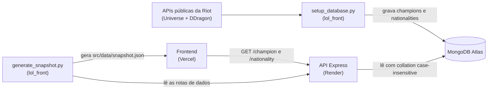

# LoL Back

API em Node.js/Express que serve dados de League of Legends (campeões e facções/regiões) a partir de um MongoDB previamente populado pelo script [`data_retrival/setup_database.py`](https://github.com/IannCarvalho/lol_front/blob/main/data_retrival/setup_database.py) do [lol_front](https://github.com/IannCarvalho/lol_front).

**Live:** https://lol-back-6zld.onrender.com (Render, plano free) · health check em [`/status`](https://lol-back-6zld.onrender.com/status).

> ⚠️ No plano free do Render o serviço "dorme" após ~15 min sem tráfego; a primeira requisição depois disso leva ~30-50s (cold start).

## Stack

- Node.js 24 (LTS) — ESM nativo (`"type": "module"`), sem step de build. O `engines` exige `>=20.19.0` (mínimo do Mongoose 9).
- Express 5 (`^5.2.1`)
- Mongoose 9 (`^9.10.1`, MongoDB)
- Desenvolvimento: Vitest 3 + Supertest (testes) e ESLint 10 (lint)

## Arquitetura



- O **seed** (`setup_database.py`, no lol_front) busca os dados nas APIs públicas da Riot (Universe e DDragon) e grava nas coleções `champions` e `nationalities`.
- A **API** (este repositório) lê o Mongo e serve as rotas de leitura, com cache HTTP e CORS.
- O **`generate_snapshot.py`** (lol_front) lê as rotas desta API e gera o snapshot estático que o frontend usa para abrir a exploração (regiões e campeões por região) sem esperar o cold start. O detalhe de um campeão é pedido a esta API.

## Estrutura

```
lol_back/
├── app.js              # entrypoint: env, abre o Mongo, createApp, listen, desligamento gracioso
├── index.js            # agrega os routers (/champion, /nationality)
├── lib/
│   ├── createApp.js    # fábrica do app Express (pura e testável: CORS, JSON, /status, 404, erro)
│   └── database.js     # conexão com o MongoDB (dbName 'lol')
├── controllers/        # rotas HTTP (champion, nationality) — handlers async diretos
├── services/           # regras de negócio + queries (.lean(), collation case-insensitive)
├── models/             # schemas Mongoose (com índices nos campos de busca)
├── middleware.js       # cache HTTP (Cache-Control) e tratador de erro central
├── util.js             # erros tipados (AppError, NotFoundError, BadRequestError) e mapMongooseError
├── eslint.config.js    # configuração do ESLint (flat config)
└── render.yaml         # Blueprint do Render (NODE_VERSION 24)
```

## Setup

```bash
npm install
cp .env_template .env   # e preencha os valores
```

Variáveis de ambiente (`.env`):

| Variável           | Descrição                                                              |
|--------------------|------------------------------------------------------------------------|
| `PORT`             | Porta do servidor (default 5000 no app; o Render usa 10000 via env)    |
| `MONGO_URL`        | Connection string do MongoDB                                           |
| `ALLOWED_ORIGINS`  | Opcional: origens CORS separadas por vírgula; sobrescreve o default    |

## Scripts

```bash
npm run dev        # desenvolvimento (hot reload via node --watch)
npm start          # produção (node app.js)
npm test           # roda a suíte uma vez (Vitest)
npm run test:watch # testes em modo watch
npm run lint       # ESLint em todo o projeto
```

> O `dotenv` carrega o `.env` automaticamente. Health check: `GET /status` → `Status: Running`.

O entrypoint faz **desligamento gracioso** em `SIGTERM`/`SIGINT` (o Render manda `SIGTERM` em deploy e ao hibernar): para de aceitar conexões, fecha a conexão com o Mongo e só então encerra o processo.

## Endpoints

| Método | Rota                                   | Descrição                          |
|--------|----------------------------------------|------------------------------------|
| GET    | `/status`                              | Health check (sem cache)           |
| GET    | `/nationality/`                        | Lista todas as regiões/facções     |
| GET    | `/nationality/:name`                   | Detalhe de uma região (nome sem diferenciar maiúsculas) |
| GET    | `/nationality/champions/:nationality`  | Campeões de uma região (pelo slug) |
| GET    | `/champion/:slug`                      | Detalhe de um campeão              |

As rotas de dados respondem com `Cache-Control: public, max-age=600` (via o middleware `cacheControl`); o `/status` fica fora do cache para refletir o estado atual do serviço.

### Exemplos

Trechos reais do banco (textos e URLs longos encurtados com `…`):

```bash
curl https://lol-back-6zld.onrender.com/nationality/ionia
```

```json
{
  "_id": "…",
  "slug": "ionia",
  "image": "https://universe.leagueoflegends.com/images/iona_emblem.png",
  "name": "Ionia",
  "overview": "Rodeada por águas traiçoeiras, Ionia é composta por várias províncias aliadas…",
  "background": "https://cmsassets.rgpub.io/sanity/images/…"
}
```

```bash
curl https://lol-back-6zld.onrender.com/champion/ahri
```

```json
{
  "_id": "…",
  "release-date": "2011-12-14T00:00:00.000Z",
  "name": "Ahri",
  "title": "a Raposa de Nove Caudas",
  "section-title": "Ahri",
  "slug": "ahri",
  "image": "https://ddragon.leagueoflegends.com/cdn/16.18.1/img/champion/Ahri.png",
  "background": "https://cmsassets.rgpub.io/sanity/images/…",
  "url": "/pt_br/champion/ahri",
  "role": [{ "name": "Mago", "slug": "mage" }, { "name": "Assassino", "slug": "assassin" }],
  "nationality": "ionia",
  "lore": "A ligação de Ahri com a magia do mundo espiritual é inata…"
}
```

Os campos vêm do seed: **nationality** traz `slug, name, image, background, overview`; **champion** traz `slug, name, title, lore, nationality, image, background` (o `nationality` é o slug da região) mais os extras da Riot (`release-date`, `section-title`, `url`, `role`) e o `_id` do Mongo.

## Contrato de erro

Toda resposta de erro é um JSON `{ "message": "..." }`:

| Status | Quando                                                        | Corpo                                  |
|--------|---------------------------------------------------------------|----------------------------------------|
| 400    | Valor inválido para o campo (CastError/ValidationError do Mongoose) | `{ "message": "Invalid value for field '<campo>'." }` |
| 403    | Origem não permitida pelo CORS                                | `{ "message": "Origin not allowed by CORS." }` |
| 404    | Recurso não encontrado ou rota inexistente                    | `{ "message": "Champion not found." }`, `{ "message": "Nationality not found." }` ou `{ "message": "Route not found." }` |
| 500    | Erro interno (ex.: banco indisponível no cold start)          | `{ "message": "Internal server error." }` — mensagem genérica; o erro completo vai para o log do servidor |

- **Lista vazia é `200 []`**, não 404: uma região sem campeões responde lista vazia, e o frontend conta com isso.
- Erros de infraestrutura (rede ou timeout do Mongo) viram **5xx**, nunca 400, e a mensagem interna não vaza para o cliente.

## Busca por nome (collation)

As consultas por nome usam **igualdade com collation case-insensitive** (locale `en`, strength 2), e não `$regex`. A troca, feita no [PR #6](https://github.com/IannCarvalho/lol_back/pull/6), permite usar o índice do campo, que o `$regex` case-insensitive sem âncora não aproveitava. Os índices em `models/*.js` declaram a mesma collation. Campos indexados: `slug` e `nationality` em `champion`, e `name` em `nationality`.

## CORS

Sem `ALLOWED_ORIGINS`, o CORS libera o frontend em produção (`https://lolfront.vercel.app`) e o dev local (`http://localhost:5500`, `http://127.0.0.1:5500`). `ALLOWED_ORIGINS` (lista separada por vírgula) sobrescreve esse default — útil para liberar previews sem mexer no código. Requisições **sem header Origin** (curl, health check) são liberadas; origens fora da lista recebem 403. A API é só de leitura, então anuncia apenas os métodos `GET` e `HEAD`.

## Deploy (Render)

O repositório inclui um `render.yaml` (Blueprint): runtime Node, `NODE_VERSION=24`, plano free, health check em `/status` e `PORT=10000`. Ao criar um **Blueprint** apontando para este repositório, o Render pede o valor de `MONGO_URL` (a connection string do Atlas, que não vai versionada).

Pontos de atenção no MongoDB Atlas:
- **Network Access**: libere `0.0.0.0/0` (o Render free não tem IP fixo); senão a conexão falha com erro de TLS/seleção de servidor.
- O nome do banco (`lol`) é forçado via `dbName` em `lib/database.js`, então a `MONGO_URL` funciona com ou sem o `/lol` no path.

## Testes e lint

[Vitest](https://vitest.dev/) + [Supertest](https://github.com/ladjs/supertest). Os testes cobrem os helpers de `util.js`, as rotas de `champion`/`nationality` (services mockados, sem tocar o Mongo), os headers de cache e o app real montado via `createApp` (status, 404 JSON, CORS permitido e negado, 500 genérico, `x-powered-by` ausente).

```bash
npm test
npm run lint
```

Os testes ficam em `tests/`. O CI (GitHub Actions, Node 24) roda `npm run lint` e `npm test` a cada push e pull request para `master`.

## Populando o banco

Os dados vêm do script [`data_retrival/setup_database.py`](https://github.com/IannCarvalho/lol_front/blob/main/data_retrival/setup_database.py) (no repositório lol_front), que busca as informações nas APIs públicas da Riot (Universe) e DDragon e grava nas coleções `champions` e `nationalities`.

## Licença

MIT — veja [LICENSE](./LICENSE).
